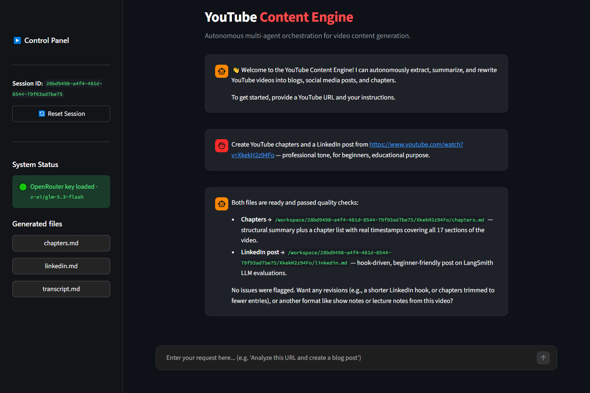
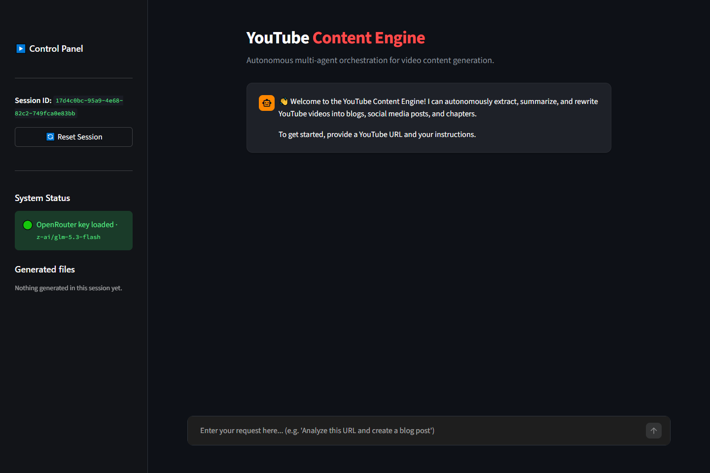
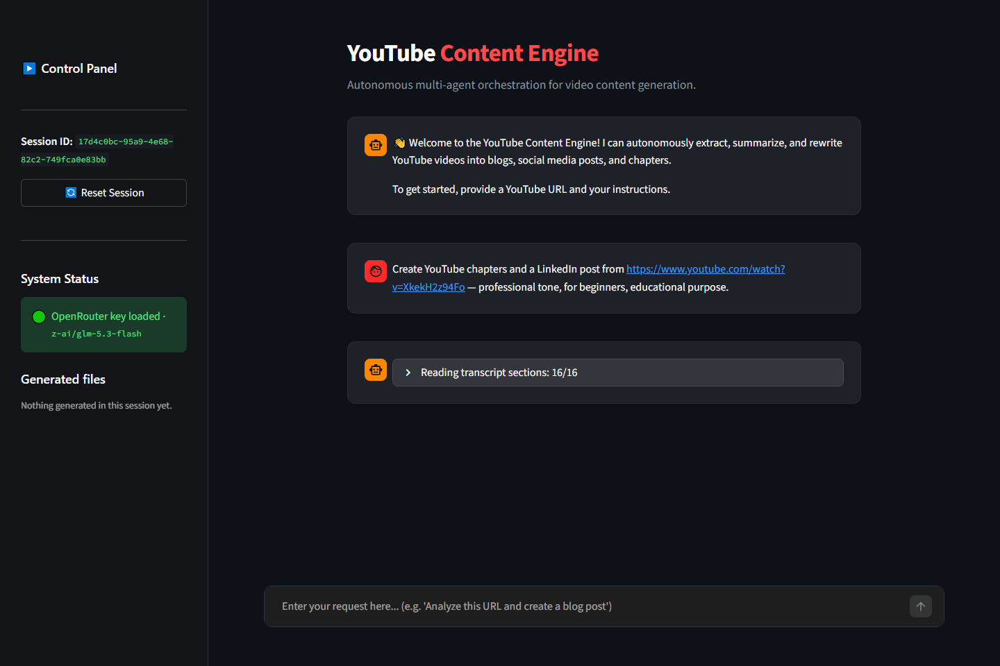
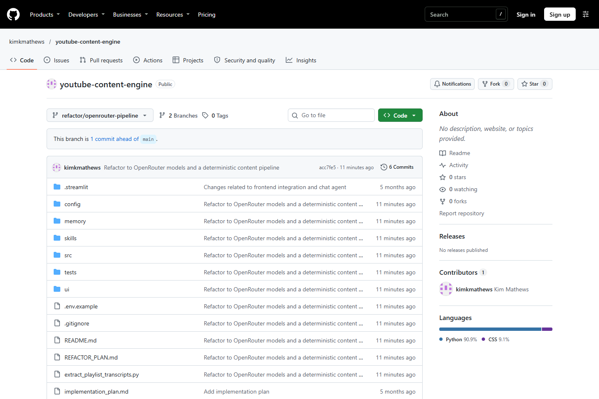
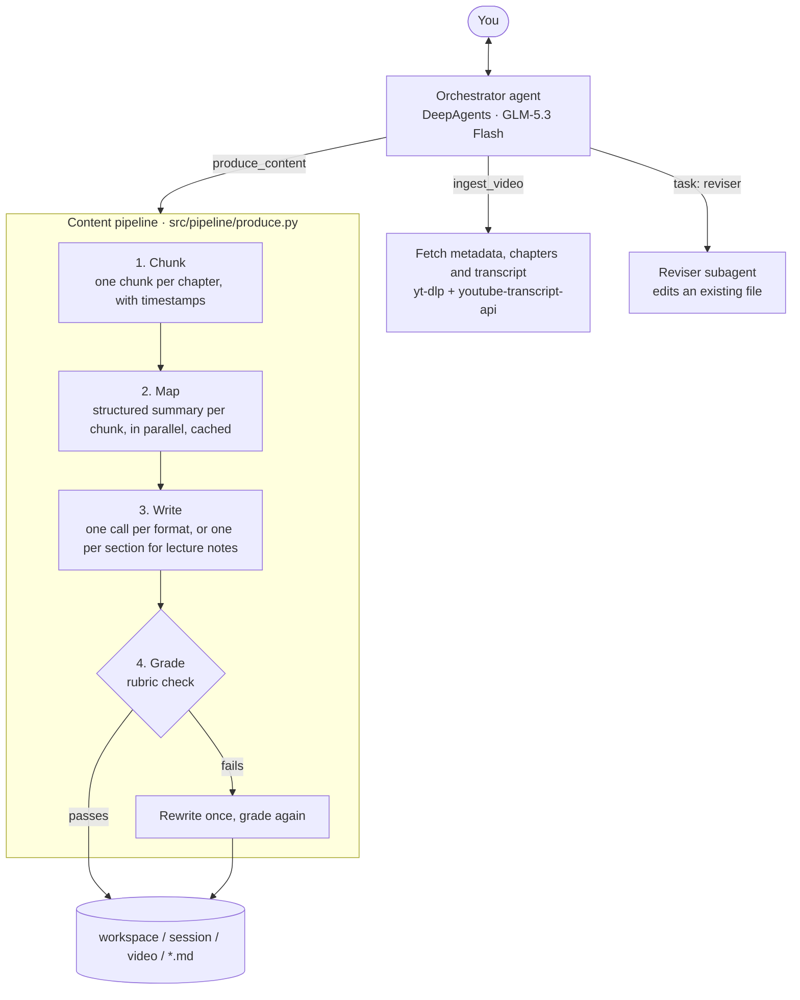

# YouTube Content Engine

Turn any YouTube video into ready-to-publish content by chatting with an agent. Paste a link and say what you need: a blog post, lecture notes, chapters with real timestamps, show notes, a LinkedIn post, an X thread, a quiz with flashcards, or an SEO pack. The engine reads the transcript, writes each format, checks it against a quality rubric, and gives you Markdown files to download.

It runs on open-weight models (DeepSeek and GLM) through [OpenRouter](https://openrouter.ai). The orchestrator is built with [LangChain DeepAgents](https://docs.langchain.com/oss/python/deepagents/overview).



## Contents

- [Features](#features)
- [Screenshots](#screenshots)
- [Quick start](#quick-start)
- [Using it](#using-it)
- [Output formats](#output-formats)
- [How it works](#how-it-works)
- [Models and cost](#models-and-cost)
- [Configuration](#configuration)
- [Project structure](#project-structure)
- [Adding a format](#adding-a-format)
- [Tests](#tests)
- [Troubleshooting](#troubleshooting)

## Features

- **Eight output formats**, each defined by one Markdown skill file. Ask for several in one message and they are produced in a single run.
- **Works on long videos.** The transcript is split along the video's own chapters, each part is summarised in parallel, and the formats are written from those summaries. A 67-minute, 16-chapter video takes about 26 model calls for four formats.
- **Quality gate.** A separate model grades every file against its format's rubric. A file that fails is rewritten once and graded again, and anything still failing is reported to you.
- **Real timestamps.** The transcript carries `[mm:ss]` markers every 30 seconds, so chapters and show notes cite real times, not invented ones.
- **Caching.** Transcripts and chunk summaries are cached by content hash. Asking for another format, or a different tone, for a video you've already processed only pays for the writing step.
- **Remembers your preferences.** Your last tone, audience and purpose are saved and offered next time.
- **Revisions.** Ask for a change to a generated file and a reviser subagent edits it in place.
- **Guard rails.** The agent may only write inside the session's workspace folder. It can't run shell commands, and each turn is limited to 40 model calls. If the main model fails, a model from a different vendor takes over.
- **Cost reporting.** Each run reports its model calls, tokens and cost in US dollars, taken from OpenRouter's usage data.
- **Two interfaces:** a Streamlit dashboard and a terminal chat.

## Screenshots

These come from a live run that asked for chapters and a LinkedIn post. Both files were ready in about a minute, because the video was already cached.

**Start screen.** The sidebar shows the session, which model is loaded, and the files generated so far.



**During a run.** The status line shows the current pipeline step. Expand it to see every step so far.



**Repository on GitHub.**



## Quick start

You need Python 3.11+, [uv](https://docs.astral.sh/uv/) and an [OpenRouter API key](https://openrouter.ai/keys).

```bash
git clone https://github.com/kimkmathews/youtube-content-engine.git
cd youtube-content-engine
uv venv
uv pip install -r requirements.txt
cp .env.example .env
```

Open `.env` and set `OPENROUTER_API_KEY`. Then start the dashboard:

```bash
.venv/Scripts/python run_ui.py
```

It opens at <http://localhost:8501>. On macOS and Linux, use `.venv/bin/python` instead of `.venv/Scripts/python`.

To chat in the terminal instead:

```bash
.venv/Scripts/python main.py
```

## Using it

Paste a link and say what you want in plain language, for example:

> Create YouTube chapters and a LinkedIn post from https://www.youtube.com/watch?v=XkekH2z94Fo -- professional tone, for beginners, educational purpose.

The agent:

1. Fetches the video and tells you its title, length, language and number of sections.
2. Asks for any setting you didn't give: the formats, and the tone, audience and purpose. If you've used it before, it offers your last settings.
3. Produces every format you asked for in one run.
4. Lists the files it wrote and anything the quality check flagged. It doesn't fix flagged items unless you ask.

Then you can follow up:

- "Make the LinkedIn post shorter and add a question at the end." The reviser edits the file in place.
- "Now do lecture notes for the same video." Only the new format is written; the video's summaries come from cache.
- "Write the blog in Spanish." Any language works.

Files are saved to `workspace/<session-id>/<video-id>/`. The dashboard sidebar has a download button for each one, and every run also saves the full timestamped transcript as `transcript.md`.

| Setting | Values |
|---|---|
| Tone | `technical`, `casual`, `professional` |
| Audience | `beginners`, `experts`, `c_suite` |
| Purpose | `educational`, `promotional`, `entertainment` |

## Output formats

| Format | File | What you get | Written |
|---|---|---|---|
| Blog post | `blog.md` | Long-form article citing timestamps | in one pass |
| Chapters | `chapters.md` | Summary, then a chapter list with real timestamps | in one pass |
| Lecture notes | `lecture_notes.md` | Detailed study notes, one section per chapter | section by section |
| LinkedIn post | `linkedin.md` | Hook, key takeaways, call to action, hashtags | in one pass |
| Show notes | `show_notes.md` | Ready-to-paste video description with timestamps | in one pass |
| Quiz and flashcards | `quiz_flashcards.md` | Multiple-choice quiz with explanations, plus Anki-importable cards | in one pass |
| X thread | `x_thread.md` | A thread of 6 to 12 posts | in one pass |
| SEO pack | `seo_pack.md` | Title options, meta description, tags, keywords, thumbnail text | in one pass |

A sample from `chapters.md`, generated for a 67-minute LangSmith tutorial:

```text
00:00 -- Introduction and Course Scope — The video introduces LangSmith evaluation for LLM
systems and agents, argues that evaluations are the most important and overlooked part of
LLM engineering, and previews datasets, experiments, LLM-as-a-judge, golden datasets, and labs.

01:32 -- Why LLM Evaluations Matter — The section contrasts predictable traditional software
tests with non-deterministic LLM outputs and subjective quality, explains why exact-match
testing fails, and introduces LangSmith as a structured framework for measuring quality.
```

## How it works

The work is split in two. An **agent** handles the conversation: it understands the request, asks what's missing, and calls tools. A **plain-code pipeline** produces the content, so the number of model calls is fixed and predictable rather than left to the agent.



| Step | What happens | Model |
|---|---|---|
| Ingest | Fetches the title, chapters and transcript, preferring English and falling back to the first available language or YouTube's own captions. Splits it into chunks along the chapters. | none |
| Map | Turns each chunk into a structured summary: key points, specifics and notable moments, each with timestamps. These are shared by every format and cached. | worker |
| Write | Writes each format from the summaries. Lecture notes are written one section per chunk so that no detail is lost, then given an introduction and closing. | writer |
| Grade | Checks each file against its rubric and lists failed criteria. A failing file is rewritten once using that list. | grader |

The orchestrator is a DeepAgents agent with:

- **Tools:** `ingest_video`, `produce_content`, file read and edit, and `task` for the reviser.
- **Middleware:** your saved preferences added to the prompt, Markdown clean-up on files it writes or edits, tool retry, a cap on model calls per turn, and a fallback model.
- **Memory:** `memory/AGENTS.md`, which describes the workflow it follows.
- **Persistence:** conversations are checkpointed to `state.db` and preferences are kept in `preferences.db` (SQLite), so a session can be resumed.

## Models and cost

Each role uses its own model, chosen from OpenRouter's catalogue:

| Role | Default model | Why |
|---|---|---|
| Orchestrator | `z-ai/glm-5.3-flash` | Tuned for tool use over long conversations |
| Writer | `deepseek/deepseek-v4.1-flash-1017` | Strong long-form writing at low cost |
| Worker (summaries) | `deepseek/deepseek-v4.1-flash-1017` | Reliable structured output |
| Grader | `z-ai/glm-5.3-flash` | From a different model family than the writer, so it doesn't favour its own style |
| Fallback | `deepseek/deepseek-v4.1-flash-1017` | From a different vendor than the orchestrator |

The DeepSeek models are pinned to a dated snapshot, so output doesn't change when the model alias moves. For higher-quality writing, set `WRITER_MODEL=deepseek/deepseek-v4-pro-0813`.

Measured on a 67-minute video with 16 chapters:

| Run | Model calls | Time | Cost |
|---|---|---|---|
| Blog, chapters, LinkedIn post and lecture notes, nothing cached | 26 | about 9 min | $0.089 |
| Lecture notes only, summaries cached | 18 | 163 s | $0.046 |

These costs cover the content pipeline only. The orchestrator's own chat turns add a few cents.

Requests only go to OpenRouter hosts that support every parameter sent, that don't keep data for training, and that serve the model at 8-bit precision or higher (or don't disclose their precision).

## Configuration

Settings are read from `.env`. Only the API key is required.

| Variable | Default | Purpose |
|---|---|---|
| `OPENROUTER_API_KEY` | none | Required |
| `ORCHESTRATOR_MODEL`, `WRITER_MODEL`, `WORKER_MODEL`, `GRADER_MODEL`, `FALLBACK_MODEL` | see [Models and cost](#models-and-cost) | Model for each role, as an OpenRouter model id |
| `LLM_MAX_CONCURRENCY` | `10` | Model calls run in parallel during a run |
| `LLM_TIMEOUT_SECONDS` | `180` | Time limit for each model call |
| `LLM_MAX_RETRIES` | `3` | Retries for each model call |
| `LLM_RPM_LIMIT` | `0` (off) | Requests per minute; set about `20` for `:free` models |
| `ORCHESTRATOR_RUN_CALL_LIMIT` | `40` | Maximum orchestrator model calls per turn |
| `OPENROUTER_QUANTIZATIONS` | `fp8,fp16,bf16,unknown` | Allowed host precisions; leave empty to allow 4-bit hosts |
| `OPENROUTER_DATA_COLLECTION` | `deny` | Whether hosts may keep data for training |
| `MAX_CHUNK_TOKENS` | `40000` | Largest chunk size, for chapters that are very long |
| `LANGSMITH_TRACING`, `LANGSMITH_API_KEY` | off | Optional tracing in [LangSmith](https://smith.langchain.com) |

## Project structure

```text
youtube-content-engine/
├── run_ui.py                  # starts the Streamlit dashboard
├── main.py                    # terminal chat
├── extract_playlist_transcripts.py   # saves transcripts for a whole playlist
├── config/settings.py         # all settings, read from .env
├── memory/AGENTS.md           # the orchestrator's workflow instructions
├── skills/                    # one folder per output format
│   └── <format>/SKILL.md      # instructions, output file and rubric
├── src/
│   ├── core/
│   │   ├── runtime.py         # builds the orchestrator agent
│   │   ├── tools.py           # ingest_video and produce_content
│   │   ├── llm.py             # OpenRouter models, harness profile, cost tracking
│   │   ├── schema.py          # data models
│   │   ├── skill_files.py     # loads skills/
│   │   └── workspace.py       # keeps file paths inside the session folder
│   ├── pipeline/
│   │   ├── chunking.py        # transcript to timestamped chunks
│   │   └── produce.py         # chunk, map, write, grade
│   ├── extractors/youtube_scraper.py   # metadata, chapters and transcripts
│   └── middleware/            # preferences, quality check, Markdown clean-up
├── ui/                        # Streamlit app and styles
├── tests/                     # unit tests, no network needed
├── docs/images/               # screenshots for this README
└── REFACTOR_PLAN.md           # architecture review and roadmap
```

`workspace/`, `.env` and the `*.db` files are created at runtime and ignored by Git.

## Adding a format

Create `skills/<name>/SKILL.md`:

```yaml
---
name: my-format              # must match the folder name
description: What it is and when to use it (shown to the orchestrator)
output_file: my_format.md
strategy: reduce             # or per_chunk for long, section-by-section documents
rubric:
  - Each criterion the grader checks
---
Writing instructions for the model...
```

That's all. No Python changes are needed: the orchestrator learns about the new format from its description the next time the app starts.

## Playlist transcripts

To save the transcripts of every video in a playlist as Markdown, one file per video, with no model calls:

```bash
.venv/Scripts/python extract_playlist_transcripts.py --playlist "<playlist url>" --out output/my_playlist
```

## Tests

```bash
.venv/Scripts/python -m unittest tests.test_extractors tests.test_workspace tests.test_pipeline tests.test_runtime_wiring
```

The tests use fake models, so they need no API key or network. They cover chunking and chapter parsing, keeping paths inside the workspace, the pipeline (call counts, caching, the rewrite-on-fail path, lecture-note structure), and the agent's setup (the skill catalogue, the tools the model is given, and a full chat turn).

## Troubleshooting

- **"OPENROUTER_API_KEY not found"**: set it in `.env` in the project root, then restart the app.
- **Calls time out on a slow host**: raise `LLM_TIMEOUT_SECONDS`. Each call is retried, and the cache keeps a re-run cheap.
- **"No transcript content could be extracted"** or **"Failed to extract transcript"**: the video has no captions in any language, so there is nothing to work from.
- **yt-dlp warns about a missing JavaScript runtime**: this is harmless here. Installing [Deno](https://deno.com) removes the warning.
- **Garbled characters in a Windows terminal**: set `PYTHONIOENCODING=utf-8` before running `main.py`.
